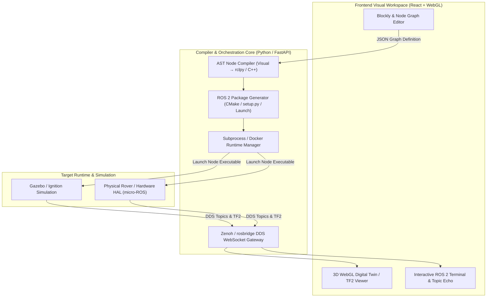

# AGY-ROS Studio (Antigravity ROS Studio)
### Next-Generation Visual Programming & Simulation IDE for ROS 2 Autonomous Robotics

[](https://docs.ros.org/)
[](https://www.python.org/)
[](https://reactjs.org/)
[](https://fastapi.tiangolo.com/)
[](https://opensource.org/licenses/MIT)

> A modern, glass-box visual programming environment and simulation IDE that translates visual blocks and node graphs into idiomatic, production-ready ROS 2 C++ and `rclpy` nodes with real-time TF2, WebGL teleoperation, and Sim-to-Real hardware support.

---

## 📌 Executive Summary

Robotics education and rapid prototyping in ROS 2 has historically suffered from a stark divide:
1. **Opaque "Toy" Block Wrappers**: Hide concurrency, DDS serialization, QoS profiles, and coordinate transform trees behind single-threaded blocking scripts.
2. **Fragmented Professional Toolchains**: Steep learning curve involving raw CMakeLists, complex Launch Python DSLs, TF2 transform debuggers, and YAML configurations.

**AGY-ROS Studio** eliminates this friction. It provides a visual block and node graph editor that compiles directly into standard, idiomatic ROS 2 packages, giving developers a live "Glass-Box" X-ray into real-time pub/sub dynamics, TF2 tree frames, and hardware execution.

---

## 🏗️ System Architecture



---

## 🌟 Key Features

- **True ROS 2 AST Generation**: Emits cleanly structured `rclpy` and C++ node classes rather than simple bash wrappers.
- **Glass-Box Telemetry**: Live inspection of DDS topics, transform trees (`/tf`, `/tf_static`), and QoS settings in real time.
- **3D Robot Digital Twin**: WebGL-based viewport displaying robot URDF models, laser scans (`sensor_msgs/LaserScan`), and point clouds.
- **Unified Build & Run Pipeline**: Automatically generates `package.xml`, `setup.py`, and Python launch files into `build_output/`.
- **Extensible MCP Architecture**: Model Context Protocol servers for automated diagnosis, package linting, and ROS 2 ecosystem integrations.

---

## 📁 Repository Structure

```text
PICK_AND_DROP/
├── backend/
│   ├── compiler/           # AST code generation engines (Visual to rclpy/C++)
│   ├── runtime/            # Process supervision, launch triggers, and container hooks
│   └── vendors/            # Specialized device adapters (wise_vision, rde_ros2)
├── frontend/
│   └── src/                # Visual blockly editors, WebGL 3D canvas, and UI panels
├── build_output/
│   └── agy_rover_bringup/  # Auto-generated ROS 2 bringup workspace & launch files
├── mcp_servers/            # Model Context Protocol micro-services
├── research/
│   └── MASTER_BLUEPRINT.md # Exhaustive 1,000+ line technical architecture specification
├── schema/                 # JSON schemas for visual nodes, blocks, and robot configs
└── README.md
```

---

## 🚀 Getting Started

### Prerequisites
- **Ubuntu**: 22.04 LTS (Jammy) or 24.04 LTS (Noble)
- **ROS 2**: Humble Hawksbill or Jazzy Jalisco
- **Python**: 3.10+
- **Node.js**: 18+ (LTS)

### Installation

1. **Clone the repository**:
   ```bash
   git clone https://github.com/entusedglue3125/agy-ros-studio.git
   cd agy-ros-studio
   ```

2. **Backend Setup**:
   ```bash
   python3 -m venv venv
   source venv/bin/activate
   pip install -r requirements.txt  # FastAPI, uvicorn, pydantic, rclpy
   ```

3. **Frontend Setup**:
   ```bash
   cd frontend
   npm install
   npm run dev
   ```

4. **Compile a Visual Project to ROS 2 Package**:
   ```bash
   python3 -m backend.compiler.cli --input schema/samples/rover_sample.json --output build_output/
   ```

5. **Launch the Generated ROS 2 Node**:
   ```bash
   source /opt/ros/humble/setup.bash
   source build_output/agy_rover_bringup/install/setup.bash
   ros2 launch agy_rover_bringup rover.launch.py
   ```

---

## 📖 Documentation

For deep technical details, competitive matrix analysis, and formal compiler specifications, read the master blueprint in:
👉 [`research/MASTER_BLUEPRINT.md`](research/MASTER_BLUEPRINT.md)

---

## 📄 License

This project is licensed under the [MIT License](LICENSE).
