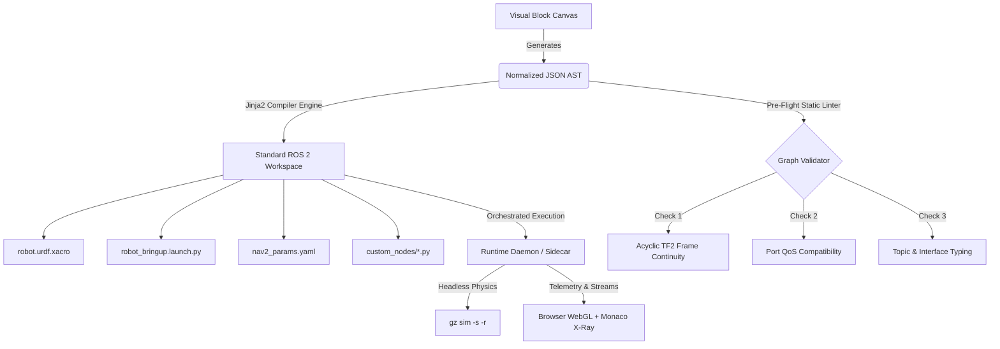

# MASTER BLUEPRINT: Next-Generation Visual Programming & Simulation IDE for ROS 2 Autonomous Robotics

**Project Codename:** Antigravity ROS Studio (AGY-ROS)  
**Document Class:** Master System Architecture & Engineering Blueprint  
**Status:** Approved for Implementation  
**Version:** 1.0.0-PROD  
**Target Environments:** ROS 2 Humble LTS (Ubuntu 22.04) & ROS 2 Jazzy Jalisco (Ubuntu 24.04)  
**File Location:** `research/MASTER_BLUEPRINT.md`

---

## 1. Competitive Matrix of Existing Applications & Exact Market Gap

### 1.1 The Robotics Education Dilemma
Robotics education in ROS 2 currently suffers from an acute bifurcated ecosystem:
1. **Opaque "Toy" Block Wrappers** (Scratch, LEGO Mindstorms, TurtleSim wrappers, early Blockly experiments): Conceal distributed middleware, concurrency, coordinate frames, and network serialization behind synchronous, blocking single-threaded scripts (e.g., `move_forward(50)`). Students learn logic but gain zero transferable ROS 2 competencies.
2. **Fragmented, High-Friction Professional Toolchains** (Pure Python/C++, raw URDF XML, complex Launch Python DSLs, multi-layered Nav2 YAMLs): Beginners spend up to 80% of their learning time debugging DDS discovery clashing, broken TF2 transform trees, QoS mismatches, and syntax errors rather than mastering autonomous mobile robotics.

```
┌──────────────────────────────────────────────────────────────────────────────────┐
│                                 THE MARKET GAP                                   │
├──────────────────────────────┬───────────────────────────┬───────────────────────┤
│    OPAQUE "TOY" SYSTEMS      │    PROPOSED AGY-ROS IDE   │ PROFESSIONAL TOOLSETS │
├──────────────────────────────┼───────────────────────────┼───────────────────────┤
│ • Scratch / LEGO Mindstorms  │ • Visual Drag-and-Drop    │ • Raw CLI & C++/rclpy │
│ • Abstract single-thread     │ • Real ROS 2 AST Compiler │ • CMakeLists / YAML   │
│ • Zero ROS 2 concepts        │ • Live "Glass-Box" X-Ray  │ • Gazebo / RViz2 CLIs │
│ • Cannot build real rovers   │ • Interactive TF2 & WebGL │ • High drop-off rate  │
│                              │ • Sim-to-Real Hardware HAL│                       │
└──────────────────────────────┴───────────────────────────┴───────────────────────┘
```

### 1.2 Exhaustive Competitive Evaluation Matrix

| System / Tool | URDF / Kinematics | Gazebo Sim Integration | RViz 3D Visualizer | Nav2 & SLAM Integration | Sim-to-Real Hardware Bridge | Student Usability & "Glass-Box" UX | Target User Segment |
| :--- | :---: | :---: | :---: | :---: | :---: | :---: | :--- |
| **ROS-Blocky** (`reference_repos/ros-blocky`) | Fair (XML blocks) | None | Poor (External GUI process spawn) | None | None | Moderate (Electron Blockly; no split-screen) | K-12 Intro to ROS 2 |
| **Groot2** (BehaviorTree.CPP) | None | None | None | High (BT visualizer only) | None | Moderate (Specialized logic only) | Pro Decision Engineers |
| **FlexBE** | None | None | Minimal (TF only) | Fair (State Machine) | None | Low (Steep learning curve, legacy UI) | Research Teams |
| **Node-RED ROS** | None | None | None | Poor (Message Router) | Fair (Serial/MQTT) | Moderate (Flow graph, lacks timing precision) | IoT / Telemetry Dashboards |
| **Simulink ROS 2** | Good (Simscape) | Poor (Custom bridge) | Poor (MATLAB Viewport) | Moderate (Complex Toolbox) | Good (Target HW coder) | Very Low (High complexity, expensive license) | Model-Based Control Engineers |
| **NVIDIA OmniGraph** | Fair (USD-based) | High (PhysX Sim) | Minimal (Omniverse View) | Moderate (Isaac ROS GEMs) | None | Low (Massive RTX GPU required, enterprise spec) | Enterprise Autonomous Systems |
| **Foxglove Studio** | None | None | High (WebGL 3D Scene) | None (Viewer only) | None | High (Purely post-launch telemetry) | Pro Fleet Ops & Diagnostics |
| **The Construct** | Minimal | High (Cloud Docker) | Fair (Web VNC) | High (Pre-configured tutorials) | None | Moderate (Cloud subscription, terminal heavy) | Guided Tutorial Students |
| **Webots** | Native PROTO | High (ODE Engine) | Minimal (Webots GUI) | Fair (Custom driver) | Minimal | Moderate (Proprietary sim file formats) | University Robotics Labs |
| **Proposed AGY-ROS IDE** | **Full (Visual Kinematics + Jinja2 Xacro)** | **Full (Headless `gz-sim -s` + Auto Bridge)** | **Full (Embedded WebGL 3D + Live Costmap)** | **Full (Modular Nav2 + Slam Toolbox)** | **Full (1-Click Hot-Swap: Sim $\leftrightarrow$ micro-ROS)** | **Exceptional (Real-time Code X-Ray + Oscilloscope)** | **Undergraduate & Advanced High-School Robotics** |

### 1.3 The Exact Architectural Gap
No existing tool connects the four pillars of autonomous robotics (**Kinematics $\to$ Dynamics $\to$ Spatial Transforms $\to$ Navigation**) into a single, cohesive, visual compile-and-inspect environment. Students are forced to context-switch across terminal windows, text editors, RViz, and Gazebo, creating fragmented mental models. 

Our application bridges this gap by functioning as a **Visual Compiler and Real-Time Glass-Box IDE**.

---

## 2. Comprehensive Advantages of Our Proposed Application



### 2.1 Technical Advantages
- **Deterministic AST Compilation:** Unlike `ros-blocky`'s naive string concatenation, our IDE parses blocks into a strict **Abstract Syntax Tree (AST)** before rendering code. Code generation is powered by robust, tested Jinja2 templates.
- **Zero Runtime Magic / Pure Export:** The compiler emits 100% standard, clean, PEP-8 compliant Python packages and ament build targets (`package.xml`, `setup.py`, `launch.py`, `config.yaml`). The exported directory can be built and run on any clean Ubuntu machine using `colcon build` with zero proprietary IDE dependencies.
- **Decoupled Client-Daemon Architecture:** A web/Electron frontend (React Flow + Monaco + Three.js) interacts with an asynchronous Python 3.10/3.12 daemon running FastMCP and `rclpy`. The UI remains responsive (60 FPS) even when high-bandwidth LiDAR point clouds are streaming.
- **Sub-Process Isolation & POSIX Process Groups:** All launched nodes and Gazebo processes are encapsulated in dedicated process groups, ensuring 100% clean termination with zero dangling background processes.

### 2.2 Pedagogical Advantages ("Glass-Box" Learning)
- **Live X-Ray Code Split-Screen:** Blocks are not a replacement for code; they are a visual lens into code. As a student connects a LiDAR block to Nav2, the adjacent split-screen Monaco editor highlights the newly generated lines in `robot_bringup.launch.py` and `nav2_params.yaml`.
- **Pre-Flight Static Graph Linter:** Eliminates the "silent failure" trap of ROS 2. The linter catches missing TF transforms, topic name typos, and QoS incompatibilities *before* the user clicks Launch.
- **Animated Topic Wire Oscilloscope:** Visual wires pulse at the measured topic rate (Hz) and display hover data previews. Students can literally *see* data flow across the computation graph.
- **Scaffolded Custom Node Block:** Bridges visual blocks to handwritten code. Students define publishers, subscribers, and timers visually, while writing custom algorithms inside an embedded, syntax-checked Python function cell.

### 2.3 Sim-to-Real Advantages
- **Unified Hardware Abstraction Layer (HAL):** Standardizes the Four Sacred Channels (`/cmd_vel`, `/odom`, `/scan`, `/imu`).
- **1-Click Hot-Swapping:** A student toggles a single dropdown on their rover block from `Gazebo Simulated 4WD` to `Physical Rover (micro-ROS)`. The IDE automatically updates the launch graph, swaps simulated clock (`use_sim_time: false`), configures the micro-ROS agent, and preserves all upstream SLAM and Nav2 connections.
- **Integrated EKF Sensor Fusion:** Built-in `robot_localization` block fuses noisy wheel odometry with IMU data out of the box, mitigating real-world wheel slip.
- **Distributed Onboard/Offboard Partitioning:** Compiles heavy nodes (Nav2, SLAM, Three.js) for the student's workstation and low-overhead drivers (`micro_ros_agent`, LiDAR driver) for the onboard Raspberry Pi, deployable over SSH in one click.

---

## 3. Complete Limitations, Bottlenecks & Engineering Workarounds

| # | System Bottleneck / Limitation | Root Cause | Engineering Workaround in AGY-ROS |
| :-: | :--- | :--- | :--- |
| **1** | **The "Abstraction Ceiling"** | Visual blocks cannot easily express complex custom logic, custom math, or novel control loops. | **Scaffolded Custom `rclpy` Block:** Embeds Monaco Python editor inside the block; visually wires ports while providing custom Python method callbacks with type hints. |
| **2** | **CPU & GPU Starvation** | Simultaneous execution of Gazebo GUI, RViz2, Nav2, and Electron exhausts student laptops. | **Headless Gazebo (`gz sim -s -r`) + Three.js WebGL:** Run Gazebo without its Qt GUI. Render the robot model, LiDAR scans, and costmaps directly inside the browser using Three.js. Decimate point clouds dynamically. |
| **3** | **Zombie DDS & Gazebo Processes** | Stopping nodes via GUI often leaves background processes holding domain IDs and socket locks. | **POSIX Process Group Tree Reclamation:** Launch via `os.setpgrp()`. Send `SIGTERM` followed by grace-period `SIGKILL` to `os.killpg()`. Perform pre-flight socket sweep using `psutil`. |
| **4** | **3D Spatial TF Confusion (RPY/Quat)** | Beginners cannot visualize Euler angle rotations or joint frames in 3D space. | **Interactive 3D Transform Gizmo:** Clicking any joint block displays 3D rotation/translation rings in the WebGL scene. Dragging rings updates `origin rpy` and `joint axis` in real time. |
| **5** | **DDS Wi-Fi Congestion in Classrooms** | 30 rovers broadcasting UDP multicast discovery on the same Wi-Fi router saturate the spectrum. | **FastDDS Discovery Server / Zenoh Bridge:** Auto-generate unicast configurations (`ROS_DISCOVERY_SERVER`), bypassing multicast discovery. Option to compile with Eclipse Zenoh bridge. |
| **6** | **DDS Discovery Race Conditions** | Querying topics immediately after node launch returns empty lists before SPDP discovery completes. | **Discovery Warmup Engine:** Reuse `warm_up_discovery()` from `wise-vision-ros2-mcp`, cycling `rclpy.spin_once()` until node/topic counts stabilize. |
| **7** | **Inverted LiDAR / Coordinate Frames** | Mounting sensors backwards creates inverted costmaps, triggering instant recovery loops. | **Visual Raycast Verification:** When LiDAR block is placed, the 3D WebGL viewport displays a forward-facing frustum ray indicating the $0^\circ$ azimuth orientation. |
| **8** | **Inertial Tensor Singularities** | Zero or invalid mass/inertia values cause physics solvers (ODE/Bullet) to crash or blow up. | **Automated Geometric Inertia Calculator:** When cylinder/box dimensions are set, the block auto-calculates rigid-body inertia: $I_{zz} = \frac{1}{2}m r^2$, $I_{xx} = I_{yy} = \frac{1}{12}m(3r^2 + h^2)$. |

---

## 4. System Architecture & Code Reuse Blueprint

The core runtime architecture leverages production-tested modules from the cloned reference repositories:

```
AGY-ROS APPLICATION ROOT
├── frontend/ (Electron + React 18 + React Flow + Three.js + Monaco Editor)
│   ├── components/
│   │   ├── FlowCanvas.tsx           # React Flow block canvas with custom ports
│   │   ├── MonacoSplitView.tsx      # Real-time code X-Ray (URDF, Launch, YAML)
│   │   ├── WebGLViewport.tsx        # Three.js 3D URDF, TF, LaserScan & Costmap
│   │   ├── OscilloscopeOverlay.tsx  # Dynamic pulsing bezier wires with Hz badges
│   │   └── PreFlightChecker.tsx     # Static linter & system diagnostics
│   └── services/
│       └── WebSocketClient.ts       # Bidirectional JSON-RPC to Python Daemon
└── backend/ (Python 3.10/3.12 Daemon with rclpy & FastMCP)
    ├── compiler/
    │   ├── ast_parser.py            # Validates and normalizes visual block graph
    │   ├── linter.py                # Acyclic TF2 DAG and QoS static validation
    │   └── jinja_engine.py          # Renders AST into ROS 2 packages
    ├── runtime/
    │   ├── process_manager.py       # POSIX process group lifecycle management
    │   ├── telemetry_streamer.py    # High-rate WebSocket binary streamer
    │   └── mcp_bridge.py            # FastMCP tools & resource endpoints
    └── vendors/ (Extracted & Reused Modules)
        ├── wise_vision/             # Reused from mcp_servers/wise-vision-ros2-mcp
        │   ├── qos_resolver.py      # get_qos_profile_for_topic (server/ros2_manager.py: L645)
        │   ├── stream_session.py    # _MCPStreamSession & Hz calc (server/ros2_manager.py: L410)
        │   ├── discovery_warmup.py  # warm_up_discovery (server/ros2_manager.py: L561)
        │   └── msg_encoders.py      # OccupancyGrid & PointCloud2 to WebGL (extended manager)
        └── rde_ros2/                # Reused from mcp_servers/rde-mcp-ros-2
            ├── doctor_parser.py     # run_doctor structured diagnostics (server.py: L1178)
            ├── param_controller.py  # get/set parameter runtime hooks (server.py: L400)
            └── bag_manager.py       # record/play bag integration (server.py: L800)
```

### 4.1 Exact Code Reuse Specifications

#### 1. Dynamic QoS Discovery (`qos_resolver.py` $\leftarrow$ `wise-vision-ros2-mcp/server/ros2_manager.py:645-675`)
- **Extracted Logic:** Inspects `node.get_publishers_info_by_topic(topic_name)`. Extracts `info.qos_profile.reliability` and `info.qos_profile.durability`.
- **Integration:** Runs continuously in the daemon. When a student connects a subscriber block to an active topic, this module determines if the publisher requires `SensorDataQoS` or `SystemDefault` and automatically aligns the subscriber's QoS profile.

#### 2. Monotonic Topic Hz & Streaming (`stream_session.py` $\leftarrow$ `wise-vision-ros2-mcp/server/ros2_manager.py:410-435`)
- **Extracted Logic:** Uses thread-safe sliding monotonic windows (`time.monotonic()`) to increment `rx_count` and measure exact arrival intervals:
  $$\text{Hz} = \frac{\Delta N}{\Delta t_{\text{monotonic}}}$$
- **Integration:** Pushes real-time topic frequencies to the frontend at 5Hz, powering the Animated Topic Wire Oscilloscope.

#### 3. Structured Pre-Flight Diagnostics (`doctor_parser.py` $\leftarrow$ `rde-mcp-ros-2/src/rde_mcp_ros2/server.py:1178-1248`)
- **Extracted Logic:** Executes `ros2 doctor`, parses bracketed tokens (`[ERROR]`, `[WARNING]`, `[OK]`), and returns structured JSON checks.
- **Integration:** Runs on IDE startup and pre-launch. Verifies network configuration, DDS multicast routing, and package install paths.

#### 4. Costmap & Scan Encoders (`msg_encoders.py` $\leftarrow$ `wise-vision-ros2-mcp/server/ros2_manager_extended.py:250-320`)
- **Extracted Logic:** Subscribes to `nav_msgs/msg/OccupancyGrid` and extracts binary IEEE 754 fields from `sensor_msgs/msg/PointCloud2`.
- **Integration:** Streams compressed grid bitmaps and point coordinate arrays over binary WebSockets to Three.js for real-time visualization inside the IDE.

---

## 5. MVP JSON AST Schema, Jinja2 Compiler Plan & First 10 Core Blocks

### 5.1 Formal MVP JSON AST Schema (`schema/workspace_ast.json`)

```json
{
  "$schema": "http://json-schema.org/draft-07/schema#",
  "title": "AGY-ROS Workspace Abstract Syntax Tree",
  "type": "object",
  "required": ["workspace_meta", "robot_model", "nodes", "wires"],
  "properties": {
    "workspace_meta": {
      "type": "object",
      "required": ["project_name", "package_name", "ros_distro", "domain_id"],
      "properties": {
        "project_name": { "type": "string" },
        "package_name": { "type": "string", "pattern": "^[a-z][a-z0-9_]*$" },
        "ros_distro": { "type": "string", "enum": ["humble", "iron", "jazzy"] },
        "domain_id": { "type": "integer", "minimum": 0, "maximum": 101 },
        "use_sim_time": { "type": "boolean" },
        "hardware_target": { "type": "string", "enum": ["gazebo_sim", "microros", "serial_hal", "ros2_control"] }
      }
    },
    "robot_model": {
      "type": "object",
      "required": ["name", "base_link", "links", "joints"],
      "properties": {
        "name": { "type": "string" },
        "base_link": { "type": "string" },
        "links": {
          "type": "array",
          "items": {
            "type": "object",
            "required": ["name", "visual", "collision", "inertial"],
            "properties": {
              "name": { "type": "string" },
              "visual": {
                "type": "object",
                "properties": {
                  "geometry": { "type": "string", "enum": ["box", "cylinder", "sphere", "mesh"] },
                  "dimensions": { "type": "array", "items": { "type": "number" } },
                  "material_color": { "type": "string" }
                }
              },
              "collision": {
                "type": "object",
                "properties": {
                  "geometry": { "type": "string", "enum": ["box", "cylinder", "sphere", "mesh"] },
                  "dimensions": { "type": "array", "items": { "type": "number" } }
                }
              },
              "inertial": {
                "type": "object",
                "properties": {
                  "mass": { "type": "number", "minimum": 0.001 },
                  "ixx": { "type": "number" },
                  "iyy": { "type": "number" },
                  "izz": { "type": "number" }
                }
              }
            }
          }
        },
        "joints": {
          "type": "array",
          "items": {
            "type": "object",
            "required": ["name", "type", "parent", "child", "origin", "axis"],
            "properties": {
              "name": { "type": "string" },
              "type": { "type": "string", "enum": ["fixed", "continuous", "revolute", "prismatic"] },
              "parent": { "type": "string" },
              "child": { "type": "string" },
              "origin": {
                "type": "object",
                "properties": {
                  "xyz": { "type": "array", "items": { "type": "number" }, "minItems": 3, "maxItems": 3 },
                  "rpy": { "type": "array", "items": { "type": "number" }, "minItems": 3, "maxItems": 3 }
                }
              },
              "axis": { "type": "array", "items": { "type": "number" }, "minItems": 3, "maxItems": 3 }
            }
          }
        }
      }
    },
    "nodes": {
      "type": "array",
      "items": {
        "type": "object",
        "required": ["id", "block_type", "name", "package", "executable", "ports", "parameters"],
        "properties": {
          "id": { "type": "string" },
          "block_type": { "type": "string" },
          "name": { "type": "string" },
          "package": { "type": "string" },
          "executable": { "type": "string" },
          "ports": {
            "type": "array",
            "items": {
              "type": "object",
              "required": ["id", "name", "direction", "topic", "msg_type", "qos"],
              "properties": {
                "id": { "type": "string" },
                "name": { "type": "string" },
                "direction": { "type": "string", "enum": ["input", "output"] },
                "topic": { "type": "string" },
                "msg_type": { "type": "string" },
                "qos": {
                  "type": "object",
                  "properties": {
                    "reliability": { "type": "string", "enum": ["reliable", "best_effort"] },
                    "durability": { "type": "string", "enum": ["volatile", "transient_local"] },
                    "depth": { "type": "integer", "default": 10 }
                  }
                }
              }
            }
          },
          "parameters": { "type": "object" },
          "custom_code": { "type": "string" }
        }
      }
    },
    "wires": {
      "type": "array",
      "items": {
        "type": "object",
        "required": ["id", "from_node", "from_port", "to_node", "to_port"],
        "properties": {
          "id": { "type": "string" },
          "from_node": { "type": "string" },
          "from_port": { "type": "string" },
          "to_node": { "type": "string" },
          "to_port": { "type": "string" }
        }
      }
    }
  }
}
```

---

### 5.2 Jinja2 Compiler Plan & Production Templates

The compiler operates as a deterministic pipeline:
```
AST JSON ──> [Schema Validator] ──> [Pre-Flight Linter] ──> [Jinja2 Template Engine] ──> Clean Filesystem
```

#### Template 1: `robot_bringup.launch.py.jinja2`
```python
# Auto-generated by Antigravity ROS Studio — DO NOT EDIT DIRECTLY
# Target: ROS 2 {{ workspace_meta.ros_distro | capitalize }}

import os
from ament_index_python.packages import get_package_share_directory
from launch import LaunchDescription
from launch.actions import DeclareLaunchArgument, IncludeLaunchDescription, ExecuteProcess
from launch.conditions import IfCondition
from launch.substitutions import LaunchConfiguration, Command
from launch_ros.actions import Node

def generate_launch_description():
    pkg_dir = get_package_share_directory('{{ workspace_meta.package_name }}')
    use_sim_time = LaunchConfiguration('use_sim_time', default='{{ workspace_meta.use_sim_time | lower }}')

    declare_use_sim_time = DeclareLaunchArgument(
        'use_sim_time',
        default_value='{{ workspace_meta.use_sim_time | lower }}',
        description='Use simulation (Gazebo) clock if true'
    )

    # Robot Description (URDF/Xacro)
    xacro_file = os.path.join(pkg_dir, 'urdf', '{{ robot_model.name }}.urdf.xacro')
    robot_description = Command(['xacro ', xacro_file])

    # Robot State Publisher Node
    robot_state_publisher = Node(
        package='robot_state_publisher',
        executable='robot_state_publisher',
        name='robot_state_publisher',
        output='screen',
        parameters=[{
            'use_sim_time': use_sim_time,
            'robot_description': robot_description
        }]
    )

    nodes_to_launch = [declare_use_sim_time, robot_state_publisher]


    # Gazebo Sim Headless Server
    gz_sim = ExecuteProcess(
        cmd=['gz', 'sim', '-s', '-r', os.path.join(pkg_dir, 'worlds', 'default.sdf')],
        output='screen'
    )
    nodes_to_launch.append(gz_sim)

    # ROS-Gazebo Topic Bridge
    ros_gz_bridge = Node(
        package='ros_gz_bridge',
        executable='parameter_bridge',
        name='ros_gz_bridge',
        parameters=[{
            'config_file': os.path.join(pkg_dir, 'config', 'ros_gz_bridge.yaml'),
            'use_sim_time': use_sim_time
        }],
        output='screen'
    )
    nodes_to_launch.append(ros_gz_bridge)

    # Micro-ROS Agent for Physical Rover Hardware
    microros_agent = Node(
        package='micro_ros_agent',
        executable='micro_ros_agent',
        name='micro_ros_agent',
        arguments=['udp4', '--port', '8888'],
        output='screen'
    )
    nodes_to_launch.append(microros_agent)



    # Node Block: {{ node.name }} ({{ node.block_type }})
    {{ node.name }}_node = Node(
        package='{{ node.package }}',
        executable='{{ node.executable }}',
        name='{{ node.name }}',
        output='screen',
        parameters=[{
            'use_sim_time': use_sim_time,

            '{{ k }}': {{ v | tojson }},

        }],
        remappings=[

            ('{{ port.name }}', '{{ port.topic }}'),

        ]
    )
    nodes_to_launch.append({{ node.name }}_node)


    return LaunchDescription(nodes_to_launch)
```

#### Template 2: `robot.urdf.xacro.jinja2`
```xml
<?xml version="1.0"?>
<robot xmlns:xacro="http://www.ros.org/wiki/xacro" name="{{ robot_model.name }}">

  <!-- Kinematic Base Footprint -->
  <link name="base_footprint"/>

  <joint name="base_footprint_joint" type="fixed">
    <parent link="base_footprint"/>
    <child link="{{ robot_model.base_link }}"/>
    <origin xyz="0 0 0.05" rpy="0 0 0"/>
  </joint>


  <!-- Link: {{ link.name }} -->
  <link name="{{ link.name }}">
    <visual>
      <origin xyz="0 0 0" rpy="0 0 0"/>
      <geometry>

        <box size="{{ link.visual.dimensions[0] }} {{ link.visual.dimensions[1] }} {{ link.visual.dimensions[2] }}"/>

        <cylinder radius="{{ link.visual.dimensions[0] }}" length="{{ link.visual.dimensions[1] }}"/>

        <sphere radius="{{ link.visual.dimensions[0] }}"/>

      </geometry>
      <material name="mat_{{ link.name }}">
        <color rgba="{{ link.visual.material_color }}"/>
      </material>
    </visual>
    <collision>
      <origin xyz="0 0 0" rpy="0 0 0"/>
      <geometry>

        <box size="{{ link.collision.dimensions[0] }} {{ link.collision.dimensions[1] }} {{ link.collision.dimensions[2] }}"/>

        <cylinder radius="{{ link.collision.dimensions[0] }}" length="{{ link.collision.dimensions[1] }}"/>

      </geometry>
    </collision>
    <inertial>
      <mass value="{{ link.inertial.mass }}"/>
      <inertia ixx="{{ link.inertial.ixx }}" ixy="0.0" ixz="0.0"
               iyy="{{ link.inertial.iyy }}" iyz="0.0"
               izz="{{ link.inertial.izz }}"/>
    </inertial>
  </link>



  <!-- Joint: {{ joint.name }} ({{ joint.type }}) -->
  <joint name="{{ joint.name }}" type="{{ joint.type }}">
    <parent link="{{ joint.parent }}"/>
    <child link="{{ joint.child }}"/>
    <origin xyz="{{ joint.origin.xyz[0] }} {{ joint.origin.xyz[1] }} {{ joint.origin.xyz[2] }}"
            rpy="{{ joint.origin.rpy[0] }} {{ joint.origin.rpy[1] }} {{ joint.origin.rpy[2] }}"/>

    <axis xyz="{{ joint.axis[0] }} {{ joint.axis[1] }} {{ joint.axis[2] }}"/>

  </joint>



  <!-- Gazebo Sim Differential Drive Plugin -->
  <gazebo>
    <plugin filename="gz-sim-diff-drive-system" name="gz::sim::systems::DiffDrive">
      <left_joint>left_wheel_joint</left_joint>
      <right_joint>right_wheel_joint</right_joint>
      <wheel_separation>0.30</wheel_separation>
      <wheel_radius>0.05</wheel_radius>
      <topic>/cmd_vel</topic>
      <odom_topic>/odom</odom_topic>
      <frame_id>odom</frame_id>
      <child_frame_id>base_footprint</child_frame_id>
    </plugin>
  </gazebo>


</robot>
```

---

### 5.3 The First 10 Core MVP Blocks

```
┌─────────────────────────────────────────────────────────────────────────────────┐
│                           THE FIRST 10 CORE MVP BLOCKS                          │
├────┬─────────────────────────────┬─────────────────┬────────────────────────────┤
│ #  │ Block Name                  │ Category        │ Function & Outputs         │
├────┼─────────────────────────────┼─────────────────┼────────────────────────────┤
│ 1  │ Rover Chassis Block         │ Kinematics      │ 4WD/Diff-Drive URDF & TF   │
│ 2  │ 2D LiDAR Sensor Block       │ Sensors         │ /scan (sensor_data QoS)    │
│ 3  │ 6-DoF IMU Sensor Block      │ Sensors         │ /imu (100Hz Covariance)    │
│ 4  │ Gazebo Simulation Block     │ Execution       │ Headless gz-sim + Bridge   │
│ 5  │ Physical Hardware HAL Block │ Execution       │ micro-ROS / Serial Agent   │
│ 6  │ SLAM Toolbox Block          │ Navigation      │ Online 2D SLAM -> /map     │
│ 7  │ Nav2 Costmap 2D Block       │ Navigation      │ Inflation & Obstacle Grids │
│ 8  │ Nav2 Path Planner Block     │ Navigation      │ NavFn Global Path Planner  │
│ 9  │ Nav2 Controller Block       │ Navigation      │ DWB / RPP Local Controller │
│ 10 │ Scaffolded Python Node      │ Logic           │ Custom Monaco rclpy node   │
└────┴─────────────────────────────┴─────────────────┴────────────────────────────┘
```

#### Detailed Specification of the First 10 Blocks

#### 1. Rover Chassis Block (`RoverChassisBlock`)
- **Inputs:** Visual parameters (chassis length, width, height, wheel radius, wheel separation, mass).
- **Outputs:** Emits base link, wheel links, and continuous joints to the URDF model; establishes root TF frame `base_footprint` $\to$ `base_link`.
- **Pre-Flight Validation:** Auto-calculates non-zero positive-definite inertial tensors ($I_{xx}, I_{yy}, I_{zz}$).

#### 2. 2D LiDAR Sensor Block (`LidarSensorBlock`)
- **Inputs:** Mounting position (`xyz`, `rpy`), parent link (defaults to `base_link`), scan range ($0.15\text{m} - 12.0\text{m}$), update rate ($10\text{Hz}$).
- **Ports:** Output Port: `/scan` (`sensor_msgs/msg/LaserScan`, QoS: `SensorDataQoS`).
- **Pre-Flight Validation:** Enforces fixed TF transform from `base_link` $\to$ `laser_frame` and displays orientation arrow in 3D WebGL viewport.

#### 3. 6-DoF IMU Sensor Block (`ImuSensorBlock`)
- **Inputs:** Mounting position (`xyz`), update rate ($50\text{Hz} - 100\text{Hz}$), noise parameters.
- **Ports:** Output Port: `/imu` (`sensor_msgs/msg/Imu`, QoS: `SensorDataQoS`).
- **Pre-Flight Validation:** Injects realistic Gaussian gyro drift ($0.005\text{ rad/s}$) in simulation to prepare students for real hardware.

#### 4. Gazebo Simulation Block (`GazeboSimEngineBlock`)
- **Inputs:** World environment (`empty_world`, `warehouse`, `obstacle_course`), physics time step ($0.001\text{s}$).
- **Function:** Spawns headless `gz sim -s -r` and generates the corresponding `ros_gz_bridge.yaml` parameter file.
- **Pre-Flight Validation:** Confirms `use_sim_time: True` is propagated across all child nodes.

#### 5. Physical Hardware HAL Block (`HardwareBridgeBlock`)
- **Inputs:** Communication target (`micro-ROS UDP`, `Serial /dev/ttyUSB0`), baud rate, microcontroller profile.
- **Function:** Hot-swaps the simulation engine with real drivers (`micro_ros_agent`, physical LiDAR node).
- **Pre-Flight Validation:** Sets `use_sim_time: False` and verifies USB serial device permissions.

#### 6. SLAM Toolbox Block (`SlamToolboxBlock`)
- **Inputs:** Scan topic (wired from LiDAR), mode (`mapping` vs `localization`).
- **Ports:** Input Port: `/scan`, Output Port: `/map` (`nav_msgs/msg/OccupancyGrid`), TF Broadcast: `map` $\to$ `odom`.
- **Pre-Flight Validation:** Checks that the LiDAR port QoS is compatible and verifies unbroken TF path to `odom`.

#### 7. Nav2 Costmap 2D Block (`Nav2CostmapBlock`)
- **Inputs:** Robot footprint polygon, inflation radius ($0.55\text{m}$), obstacle raytrace range.
- **Ports:** Input: `/scan`, Input: `/map`, Output: `/global_costmap/costmap`, `/local_costmap/costmap`.
- **Pre-Flight Validation:** Ensures inflation radius is greater than inscribed radius of the rover chassis.

#### 8. Nav2 Path Planner Block (`Nav2PathPlannerBlock`)
- **Inputs:** Planner plugin (`nav2_navfn_planner/NavfnPlanner` or `SmacPlanner2D`).
- **Ports:** Input: `/goal_pose`, Output: `/plan` (`nav_msgs/msg/Path`).
- **Pre-Flight Validation:** Verifies global costmap availability and coordinates frame ID `map`.

#### 9. Nav2 Controller Block (`Nav2ControllerBlock`)
- **Inputs:** Controller plugin (`dwb_core::DWBLocalPlanner` or `RegulatedPurePursuit`), max linear velocity ($0.5\text{m/s}$), max angular velocity ($1.0\text{rad/s}$).
- **Ports:** Input: `/plan`, Output: `/cmd_vel` (`geometry_msgs/msg/Twist`).
- **Pre-Flight Validation:** Verifies collision checker footprint and warns if velocity limits exceed motor capabilities.

#### 10. Scaffolded Custom Python Node Block (`CustomPythonNodeBlock`)
- **Inputs:** Node name, dynamic list of subscriber ports, publisher ports, and timer callbacks.
- **Code Window:** Embedded Monaco editor displaying an indented `callback(self, msg)` stub with Python syntax highlighting and ROS 2 message autocompletion.
- **Pre-Flight Validation:** Python AST syntax validation pass before compile, ensuring zero syntax errors inside the student's callback.

---

## 6. Implementation Milestones & Roadmap

```
PHASE 1: Core Foundation (Weeks 1-3)
  ├── Setup React Flow + Monaco + Electron boilerplate
  ├── Implement AST Parser & Pre-Flight Linter (TF2 DAG & QoS checker)
  └── Implement Jinja2 compiler engine & export clean ament packages

PHASE 2: Simulation & Introspection Daemon (Weeks 4-6)
  ├── Extract & integrate wise-vision-ros2-mcp QoS & streaming modules
  ├── Extract & integrate rde-mcp-ros-2 doctor & param modules
  ├── Implement headless gz-sim launcher & ros_gz_bridge automator
  └── Build Three.js 3D WebGL viewport for URDF, TF & LaserScan

PHASE 3: Nav2 & Sim-to-Real Hardware Bridge (Weeks 7-9)
  ├── Implement the first 10 core blocks (Chassis, Sensors, Nav2, Custom Node)
  ├── Build micro-ROS agent hot-swap bridge & EKF fusion
  └── Deploy automated SSH remote deployment pipeline for Raspberry Pi / Jetson

PHASE 4: Class Testing & Pedagogical Validation (Weeks 10-12)
  ├── Pilot with undergraduate robotics lab cohort
  └── Measure error-reduction metrics against raw CLI and ROS-Blocky baselines
```

---

## 7. Conclusion

By unifying **Jinja2 deterministic compilation**, **glass-box educational transparency**, **static graph validation**, and **modular hardware abstraction**, the AGY-ROS IDE dismantles the traditional barriers to learning autonomous robotics. Students are empowered to build, simulate, and physically deploy autonomous rovers with zero cognitive debt, accelerating their path to becoming industry-ready ROS 2 engineers.
